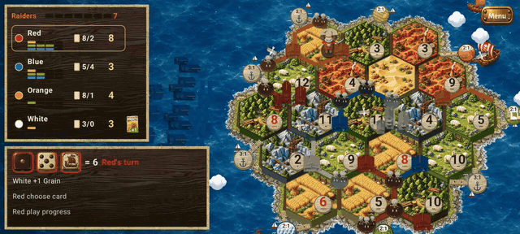

# shareable

Projects I'm sharing.

| Folder | What it is |
|---|---|
| [`working-german-board-game/`](working-german-board-game/) | Open-source Android hex-trading board game (base rules + the Age of Chivalry expansion) with a strong AI. GPL-3. |

## working-german-board-game

Open-source Android hex-trading board game (base rules + Age of Chivalry expansion) with true-random dice,
a strong-AI roadmap and play-by-file multiplayer testing. [Download the Android APK](https://github.com/cyclistmass/shareable/releases/latest/download/working-german-board-game.apk) ·
[Gameplay video](https://github.com/cyclistmass/shareable/releases/latest/download/working-german-board-game-gameplay.mp4) ·
[Project README and screenshots](working-german-board-game/README.md) ·
[Roadmap issues](https://github.com/cyclistmass/shareable/issues)
