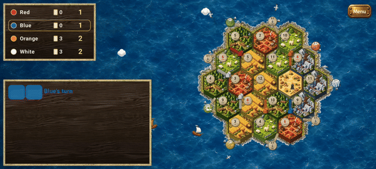

# Working German Board Game

Open-source Android hex-trading board game, compatible with the rules of the
classic German settlement-building game, for up to 4 players plus AI.
Not affiliated with or endorsed by Catan GmbH.



*Four built-in bots playing at 1x on the Android emulator: round framed sea with waves, clouds and gulls,
wooden pieces, true-random dice with the turn summary in the corner.*

License: GPL-3.0 (see `LICENSE`).

## Modules

| Module | Purpose |
|---|---|
| `engine/` | Pure Kotlin, deterministic rules engine (base game and the Age of Chivalry expansion). Runs on PC. |
| `ai/` | Pure Kotlin bots: Catanatron-style value function + AlphaBeta, later ONNX-guided search. |
| `app/` | Android UI (Jetpack Compose). |
| `trainer/` *(planned)* | PC-side Python training on a Catanatron fork, exports ONNX. |
| `net/` | Pure Kotlin transport API, local fake and deterministic online replay; Firebase adapter in `app/`. |

## Build

Requires JDK 17 and the Android SDK (`local.properties` with `sdk.dir`, not committed).

```
./gradlew :engine:test          # rules tests on PC
./gradlew :app:installDebug     # install on running emulator/device
```

Secrets (`google-services.json`, keystores, `.env`) are gitignored and must never be committed.

Online play data model, AppRoot wiring, test plan and rules deployment: [docs/online-play.md](docs/online-play.md).
